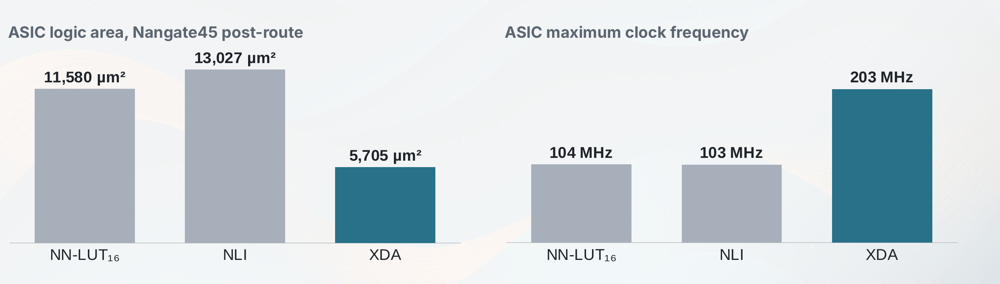
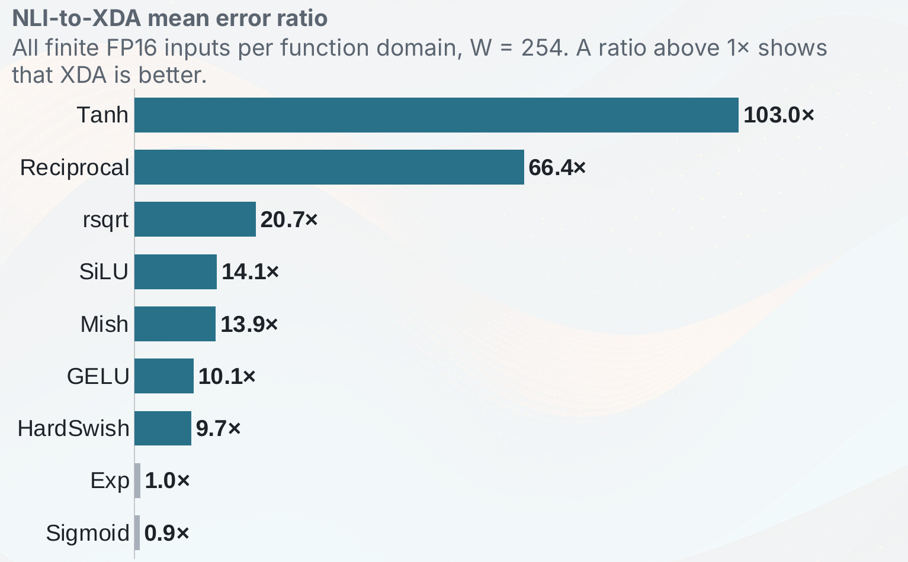
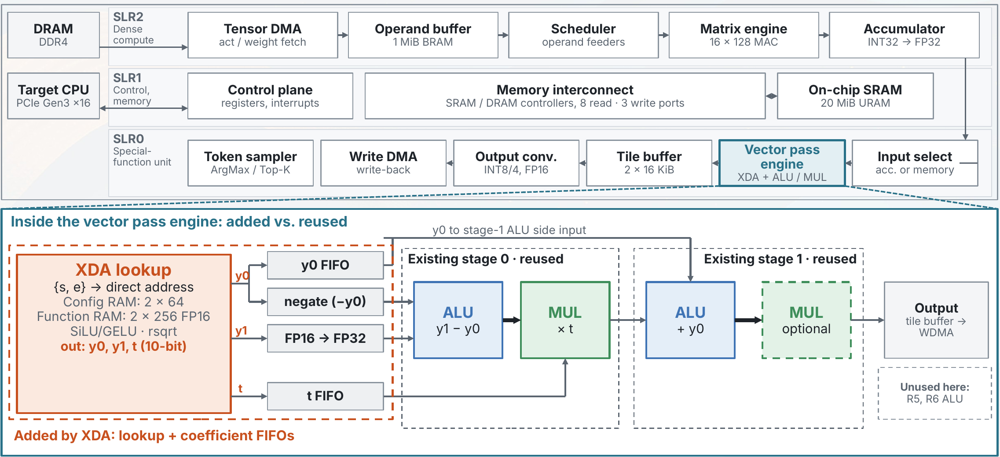
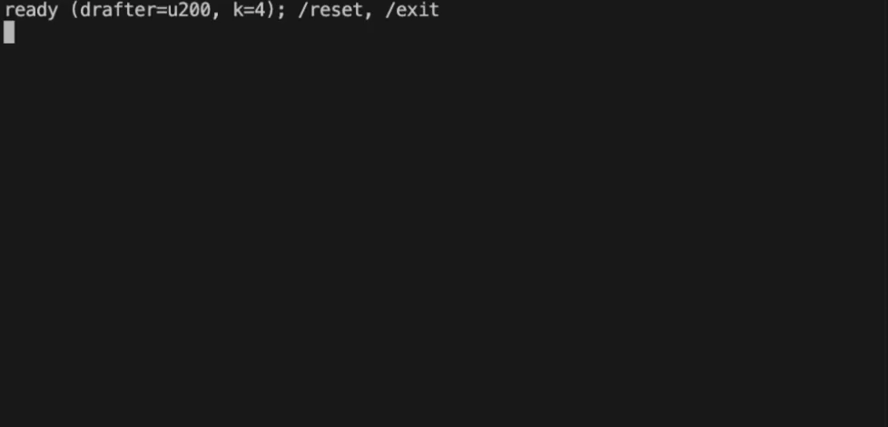
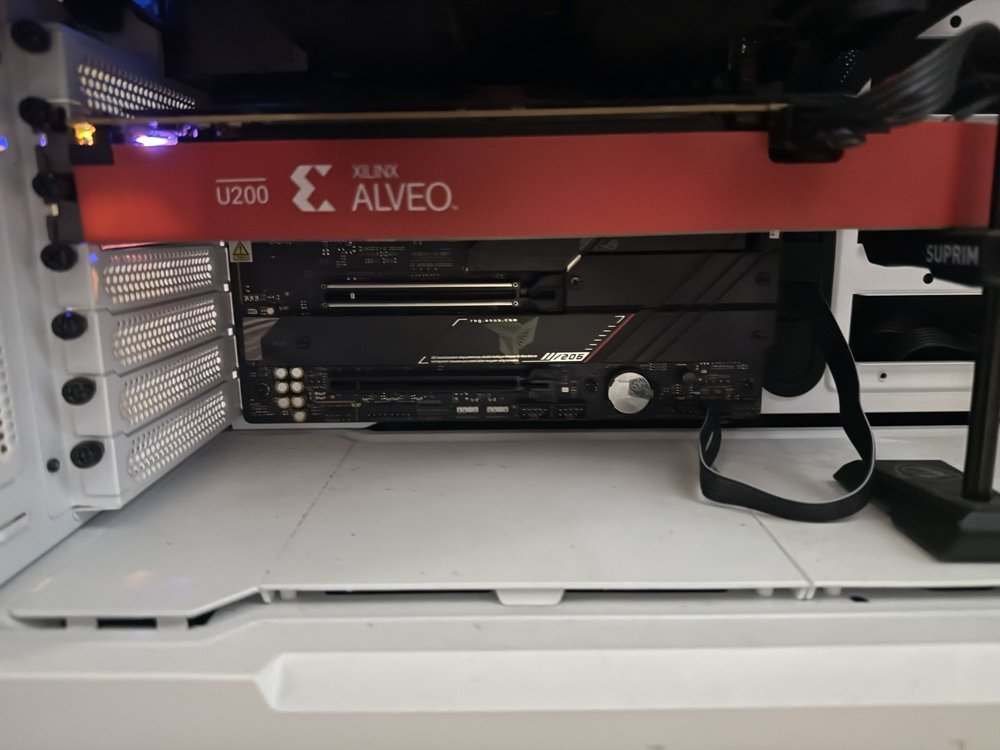
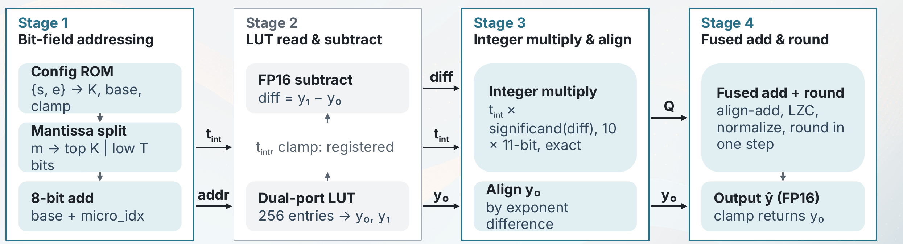

<div align="center">

# ⚡ XDA

### Representation-Aware Exponent-Direct Addressing for Efficient Shared Nonlinear Units

**Min Wu Jeong** · **Chae Eun Rhee**<br>
Department of Electronic Engineering, Hanyang University

[](#-citation)
[](https://doi.org/10.1145/3831252.3834200)
[](https://www.python.org/)
[](https://pytorch.org/)
[](hw/)
[](hw/eda_u200/eda-nli-kernel/)
[](hw/table1/asic/)

**XDA reads the LUT address directly from the FP16 bits** —<br>
half the logic, 2× the ASIC clock, LLM accuracy within 0.30 pp of FP16.

[Key Idea](#-key-idea) · [Results](#-results) · [Demo](#-demo--xda-inside-an-llm-accelerator) · [Quick Start](#-quick-start) · [Reproducing the Paper](#-reproducing-paper-tables-1-2-and-3) · [Hardware](#%EF%B8%8F-hardware-architecture) · [Citation](#-citation)

</div>

---

## 💡 Key Idea

Traditional nonlinear interpolation (NLI) needs comparators and multipliers to locate an interval and compute an address.
**XDA** removes that overhead by reading the FP16 exponent and mantissa bits *directly* as the LUT address —
**no comparators, no multipliers, just wiring.**

```
FP16 input:  [sign(1) | exponent(5) | mantissa(10)]
                 │           │              │
                 │           │         ┌────┴────┐
                 │           │     top-K bits  remaining bits
                 │           │         │           │
                 ▼           ▼         ▼           ▼
            ┌─────────────────────┐  ┌───────────────┐
            │  Config ROM lookup  │  │ Interpolation  │
            │  (bin select)       │  │ fraction t     │
            └────────┬────────────┘  └───────┬───────┘
                     │                       │
                     ▼                       ▼
              LUT[base + micro_idx]    y = y0 + t*(y1-y0)
```

<p align="center">
  <b>Supported functions (9)</b><br>
  <code>sigmoid</code> · <code>tanh</code> · <code>silu</code> · <code>mish</code> · <code>gelu</code> · <code>hardswish</code> · <code>exp</code> · <code>reciprocal</code> · <code>rsqrt</code>
</p>

## 🧩 Method Overview

| Component | Description |
|:--|:--|
| 🎯 **Exponent-Direct Addressing** | FP16 exponent bits select the bin; top-K mantissa bits select the micro-bin within it. The remaining bits become the interpolation fraction. |
| 🎒 **Knapsack DP Allocation** | Given a LUT budget *W*, allocates mantissa bits per bin to minimize total approximation error (a 0/1 knapsack). |
| 🔗 **Boundary Sharing** | Adjacent exponent bins share LUT endpoints, reducing LUT size by ~10–20% without accuracy loss. |
| 🛤️ **4-Stage FMA Pipeline** | S1 bit-extract & address gen → S2 dual SRAM read & FP16 subtract → S3 FMA multiply & align → S4 normalize & round (RNE). |

## 📈 Results

### Hardware — half the logic, 2× the ASIC clock

<p align="center"></p>

| Metric (vs. NLI) | NLI | XDA | Change |
|:--|:-:|:-:|:-:|
| FPGA CLB LUTs (XCU200, DSP-free) | 2,092 | 1,012 | **−52%** |
| FPGA F<sub>max</sub> | 101.2 MHz | 147.3 MHz | **1.45×** |
| Energy per op | 0.37 nJ | 0.21 nJ | **−43%** |
| ASIC logic area (Nangate45, post-route) | 13,027 µm² | 5,705 µm² | **−56%** |
| ASIC F<sub>max</sub> | 103.3 MHz | 203.0 MHz | **2.0×** |
| ASIC total area (logic + SRAM) | 19,337 µm² | 12,674 µm² | **−34%** |
| ASIC area–delay product (total area) | — | — | **3.0×** better |

<sub>NN-LUT<sub>16</sub> is a logic-complexity reference only; it does not keep LLM accuracy (MMLU &lt; 27). Energy = SAIF dynamic power / F<sub>max</sub>.</sub>

### Approximation accuracy — 9.7–103× lower mean error on 7 of 9 functions

<p align="center"></p>

- All finite FP16 inputs per function domain, W = 254. A ratio above 1× means XDA is better.
- **2.1–4.4× lower** error on real SiLU / Softmax / RMSNorm activations recorded from Qwen2.5-0.5B and Llama-3.2-1B.
- Exp and Sigmoid are almost equal: their useful range is narrow, so NLI's cutpoints already sit at the curve bends.

### LLM quality — within 0.30 pp of FP16

8-task zero-shot average accuracy (%) — ARC-C, ARC-E, BoolQ, PIQA, HellaSwag, OBQA, LAMBADA, WinoGrande.

| Model | FP16 | NLI | **XDA** | XDA Δ |
|:--|:-:|:-:|:-:|:-:|
| Qwen2.5-0.5B | 53.03 | 52.68 | **52.73** | −0.30 |
| Llama-3.2-3B | 64.70 | 64.44 | **64.56** | −0.14 |
| Llama-3.1-8B | 71.57 | 71.40 | **71.56** | −0.01 |
| Qwen2.5-7B | 69.82 | 69.69 | **70.00** | +0.18 |
| Qwen3-30B-A3B | 70.28 | 70.18 | **70.43** | +0.15 |

Mean absolute deviation from FP16 over 40 task–model pairs: **0.30 pp** (NLI: 0.36 pp). NN-LUT with 16 segments drops to 31–34% on the same average.

---

## 🎬 Demo — XDA inside an LLM accelerator

XDA plugs into an existing vector processing unit (VPU) as **one lookup stage** in front of its ALU and multiplier.
Below, XDA is added to the 16-lane VPU of an LLM accelerator on an AMD Alveo U200.

<p align="center"></p>

- Integration adds only the **XDA lookup** and **two coefficient FIFOs**; the VPU's ALU, multiplier, and control are reused unchanged.
- f(x) ≈ y0 + t·(y1 − y0): ① XDA lookup → ② stage 0: ALU (y1 − y0) → MUL (× t) → ③ stage 1: ALU (+ y0).
- With 16-lane replication, XDA saves **34.5%** of the nonlinear-unit area versus NLI (paper §4.6).

<table align="center">
  <tr>
    <td align="center" width="60%"></td>
    <td align="center" width="40%"></td>
  </tr>
  <tr>
    <td align="center"><sub>Live chat demo: CPU target model with the FPGA (Alveo U200) as the draft model in speculative decoding.</sub></td>
    <td align="center"><sub>The Alveo U200 board used for the demo.</sub></td>
  </tr>
</table>

---

## 🚀 Quick Start

```bash
pip install -r requirements.txt            # SW core (PyTorch, NumPy)
pip install -r requirements-llm.txt        # + LLM evaluation (paper Table 2)
```

```bash
# Full pipeline: SW -> generate .mem -> RTL sim -> Vitis build -> FPGA run
./run_pipeline.sh                          # default: hw_emu, all 9 functions
./run_pipeline.sh --target hw              # real FPGA
./run_pipeline.sh --func sigmoid           # single function only
./run_pipeline.sh --skip-sw                # skip SW experiments
```

<details>
<summary>Run individual steps</summary>

```bash
./run_pipeline.sh --step sw                # SW experiments only
./run_pipeline.sh --step gen               # generate .mem only
./run_pipeline.sh --step sim               # .mem generation + RTL simulation
./run_pipeline.sh --step build             # .mem generation + Vitis build
./run_pipeline.sh --step run               # FPGA run only (build must exist)
```

</details>

### 📋 Requirements

| Scope | Requirement |
|:--|:--|
| **SW** | Python 3, PyTorch, NumPy — `pip install -r requirements.txt` |
| **LLM eval (Table 2)** | `transformers`, `datasets`, `lm-eval` — `pip install -r requirements-llm.txt`; GPU(s) with enough memory for Llama-3.1-8B and Qwen3-30B-A3B |
| **RTL simulation** | Vivado (`xvlog` / `xelab` / `xsim`) |
| **FPGA build & run** | Vitis 2021.1+, Xilinx U200 (`xilinx_u200_gen3x16_xdma_2_202110_1`) |

---

## 📊 Reproducing Paper Tables 1, 2, and 3

| Table | What | Entry point | Output |
|:-:|:--|:--|:--|
| **1** | Post-PnR hardware (FPGA & ASIC) | [`hw/table1/README.md`](hw/table1/README.md) | FPGA / ASIC reports |
| **2** | LLM quality (5 models) | `sw/llm_eval.py` | `sw/llm_results/` |
| **3** | Approximation accuracy (Parts A/B) | `sw/run_all_experiments.py` | `sw/eda_results/all_experiments.json` |

Pre-generated outputs backing the camera-ready results are in [`artifacts/`](artifacts/).

### Table 3 — Approximation accuracy

```bash
cd sw && python3 run_all_experiments.py
# -> sw/eda_results/all_experiments.json  (exhaustive Part A + profiled Part B)
```

This rebuilds every XDA LUT configuration (Knapsack DP included), evaluates the exhaustive FP16 grids, and evaluates the NLI baseline from the paper-provided cutpoints (`nli_dp.py`).

- ✅ **Part A** (exhaustive, deterministic) reproduces the printed Table 3 values **exactly**.
- 🎲 **Part B** reproduces within its 50-trial Monte-Carlo protocol.

<details>
<summary>Notes on Part B variance</summary>

No RNG seed is fixed, matching the paper's footnote. Mean cells reproduce to ≤0.8% and all six ratio cells print identically.
Trial-averaged max cells inherit the heavy-tailed draws — the widest one (Llama RMSNorm NLI max, printed 84.4) has a measured rerun spread of 101 ± 8, so expect values near 100 there.
No comparison is affected in either direction.

</details>

### Table 2 — LLM quality

```bash
cd sw
for M in Qwen/Qwen2.5-0.5B-Instruct meta-llama/Llama-3.2-3B-Instruct \
         Qwen/Qwen2.5-7B-Instruct meta-llama/Llama-3.1-8B-Instruct Qwen/Qwen3-30B-A3B; do
  for V in baseline nli_eda nli nn_lut nn_lut_256; do
    python3 llm_eval.py --model "$M" --mode "$V"
  done
done
# -> sw/llm_results/table1_<model>_<mode>.json
```

Each run replaces **SiLU**, **Softmax** (exp + reciprocal), and **RMSNorm** (rsqrt) via PyTorch hooks and evaluates MMLU (5-shot), HumanEval, eight zero-shot tasks, and Wikitext-2 perplexity.

> [!NOTE]
> `nli_eda` is XDA's internal name. The meta-llama checkpoints are gated on Hugging Face — set `HF_TOKEN`.

- Canonical outputs behind the printed Table 2: `artifacts/llm_task_eval/results/`
- `artifacts/llm_task_eval/derive_task_mad.py` re-derives the paper's 0.30 / 0.36 pp task-level deviations from those outputs alone.
- `sw/subnormal_hitrate.py` reproduces the Sec. 4.4 rsqrt-input subnormal profiling (four models, 100 Wikitext-2 samples); a rerun log ships in the same directory.

### Table 1 — Post-PnR hardware

Complete FPGA and ASIC flows for XDA, NLI, and NN-LUT, including DSP-enabled variants: see [`hw/table1/README.md`](hw/table1/README.md).

---

## 🔧 Workflow Details

```
  ① optimize (sw)   ──▶   ② generate .mem (gen)   ──▶   ③ simulate / run on FPGA (hw)
```

<details>
<summary><b>Step 1 — SW: optimization & experiments</b></summary>

Find optimal LUT configurations for each nonlinear function via knapsack DP.

```bash
cd sw
python3 run_all_experiments.py       # Run all experiments
python3 nli_eda.py                   # XDA optimization + evaluation
python3 ablation_sweep.py            # Ablation study
```

</details>

<details>
<summary><b>Step 2 — Generate .mem files</b></summary>

Produce config ROM, function LUT, and test vectors for hardware.

```bash
# Single function
python3 gen/gen_eda_mem_fma.py --func silu --output-dir hw/eda_u200/eda-nli-kernel/src/nli_engine/

# All 9 functions — exhaustive FP16 test vectors
cd gen && python3 gen_exhaustive_mem.py
```

| File | Description |
|:--|:--|
| `config_rom.mem` | 64-entry ROM: `[clamp(1) \| reserved(3) \| k_bits(3) \| base_offset(9)]` per exponent/sign |
| `func_lut.mem` | LUT values in FP16 hex (~250–300 entries) |
| `test_vectors.mem` | `<x_hex> <y_hex>` pairs for verification |

</details>

<details>
<summary><b>Step 3a — RTL simulation (Vivado xsim)</b></summary>

```bash
cd hw/eda_u200/eda-nli-kernel/src/nli_engine

make all              # Generate .mem + simulate (default: silu)
make all FUNC=gelu    # Specify function
make sim-all          # Test all 9 functions
make sim-exhaustive   # Exhaustive FP16 verification
```

</details>

<details>
<summary><b>Step 3b — FPGA build & run (Vitis U200)</b></summary>

```bash
cd hw/eda_u200/eda-nli-kernel

# HW emulation
make all TARGET=hw_emu
make run TARGET=hw_emu FUNC=sigmoid
make run_all TARGET=hw_emu

# Real FPGA
make all TARGET=hw
make run TARGET=hw FUNC=sigmoid
make run_all TARGET=hw
```

</details>

<details>
<summary><b>Pipeline summary</b></summary>

```
sw/nli_eda.py          gen/gen_eda_mem_fma.py       hw/.../src/nli_engine/
(knapsack DP     -->  (produce .mem files)   -->   (RTL simulation, xsim)
 optimize LUT)              |
                            |  gen/gen_exhaustive_mem.py
                            v
                       hw/.../config/<func>/*.mem
                            |
                            v
                       hw/.../Makefile
                       (Vitis build -> xclbin -> FPGA run)
```

</details>

---

## 🏗️ Hardware Architecture

The U200 validation harness uses a **single** XDA engine behind 512-bit AXI read/write interfaces.
Each AXI beat packs 32 FP16 values; a PISO feeds them to the engine one value per cycle, and a SIPO collects the 32 results before the output beat is written back.

> [!NOTE]
> The 512-bit interface is a packing format, **not** a 32-engine parallel datapath.

```
DDR ──[512b AXI read]──> PISO (32 FP16 values, serialized)
                                  │ one FP16/cycle
                                  ▼
                         Single XDA Engine
                                  │ one FP16 result/cycle
                                  ▼
                         SIPO (32 results packed)
                                  │
DDR <──[512b AXI write]─────────────────────────┘
```

**4-stage pipeline (single engine)** — one FP16 result per cycle, 4-cycle latency

<p align="center"></p>


| Stage | Operation | FP gates |
|:-:|:--|:-:|
| **S1** | Bit-extract, config ROM lookup, address gen | **0** |
| **S2** | Dual SRAM read, FP16 subtract (y1 − y0) | 1 subtractor |
| **S3** | Integer multiply, exponent align | 0 (integer) |
| **S4** | Normalize, round-to-nearest-even | 1 rounder |

---

## 📁 Directory Structure

<details>
<summary>Show full tree</summary>

```
├── run_pipeline.sh              # Full pipeline automation script
├── artifacts/                   # Pre-generated outputs backing camera-ready paper results
├── sw/                          # Python software
│   ├── nli_eda.py               # XDA core: knapsack DP optimization & evaluation
│   ├── nli_eda_engine.py        # PyTorch forward-pass simulator (3/4-stage)
│   ├── ablation_sweep.py        # Ablation study (budget, bit-width, strategy)
│   ├── nli_dp.py                # NLI baseline: paper-provided cutpoints (PAPER_CUTPOINTS)
│   ├── nli_engine.py            # NLI baseline: LUT build + FP16/FP32 forward variants
│   ├── run_all_experiments.py   # Regenerates paper Table 3 (Parts A and B)
│   ├── llm_eval.py              # LLM quality eval (paper Table 2): patched models + lm-eval + PPL
│   ├── subnormal_hitrate.py     # rsqrt-input subnormal profiling (paper Sec. 4.4)
│   └── eda_results/             # Bundled inputs: optimal_domains.json, activation stats
│
├── gen/                         # Memory file generators
│   ├── gen_eda_mem.py           # Base .mem generator with bit-exact simulation
│   ├── gen_eda_mem_fma.py       # FMA-variant .mem generator (4-stage)
│   └── gen_exhaustive_mem.py    # Exhaustive FP16 test vector generation
│
└── hw/                          # Hardware RTL
    ├── fpu/
    │   └── fp_adder.v           # Parameterized FP16/FP32 adder
    ├── table1/                  # Reproduces paper Table 1 (see hw/table1/README.md)
    │   ├── fpga/                # DSP-free SAIF flow: XDA + NLI + NN-LUT RTL, Makefile, testbenches
    │   └── asic/                # OpenROAD/Nangate45 configs, fakeram macros, power estimate
    └── eda_u200/eda-nli-kernel/
        ├── src/IP/              # Kernel RTL (wrappers)
        ├── src/nli_engine/      # Standalone engine RTL + testbench
        ├── src/host/            # Host application (C++)
        ├── config/              # LUT config & test vectors (.mem)
        └── Makefile
```

</details>

---

## 📚 Baseline Implementations

The NLI and NN-LUT software/RTL in this repository are paper-based reimplementations used for the comparisons in Tables 1–3; they are not copied from upstream repositories.
The AMD/Xilinx example-derived files retain their original copyright and SPDX license headers.

---

## 📝 Citation

```bibtex
@inproceedings{jeong2026xda,
  title     = {XDA: Representation-Aware Exponent-Direct Addressing for Efficient Shared Nonlinear Units},
  author    = {Jeong, Min Wu and Rhee, Chae Eun},
  booktitle = {Proceedings of the IEEE/ACM International Conference on Computer-Aided Design (ICCAD)},
  year      = {2026},
  publisher = {ACM},
  address   = {San Jose, CA, USA},
  doi       = {10.1145/3831252.3834200}
}
```
